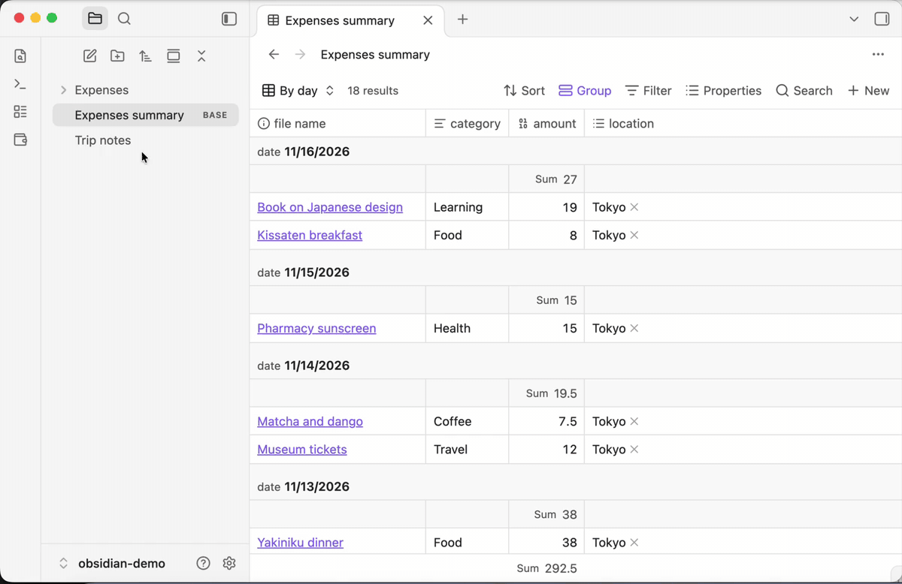

# Quick Expense

**Log an expense in seconds.** Type what you bought and how much, tap a category, done.

[中文说明](#中文说明)

## How to use

1. Click the wallet icon in the left sidebar (or run **Log an expense**).
2. Type what you bought, press Enter, type the amount.
3. Tap a category. Saved.

## What you get

- **Every expense is a note** in the `Expenses` folder, with date, category, amount and location.
- **Totals by day and month.** Click **Summary table** in settings to create a table that adds everything up.
- **Location carries over.** Log a week of trip expenses without retyping the city. Tap 📍 to change it.
- **Your categories.** Edit the list in settings. The ones you use most come first.

Want it to fit notes you already have? You can change the folder and property names in settings.

## License

MIT

---

## 中文说明

**几秒记一笔账。** 写买了什么、多少钱，点一下类别就存好。

1. 点左边栏的钱包图标（或命令「记一笔」）。
2. 写买了什么，回车，填金额。
3. 点类别，存好。

- **每笔都是一篇笔记**，在 `消费` 文件夹里，带日期、类别、金额、地点。
- **按天、按月自动合计**：设置里点「汇总表」，生成一个自动求和的表格。
- **地点自动沿用**：旅行时在一个城市连着记，不用每次填。点 📍 可以换。
- **类别自己定**：在设置里改，常用的排前面。

想和已有的记账笔记保持一致？文件夹和属性名都能在设置里改。
